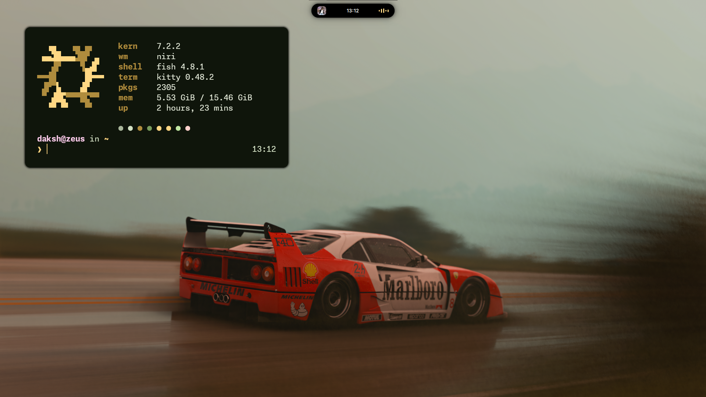

# nixdots

My NixOS + Home Manager config, as a flake.



## Setup

| | |
|---|---|
| Host | `zeus` (Intel iGPU + NVIDIA, PRIME offload) |
| Channel | nixos-unstable |
| Compositor | niri |
| Shell | [island](https://codeberg.org/pneumoniapizza/island) (Quickshell) |
| Theming | matugen, templates in `home/desktop/matugen/templates` |
| Terminal | kitty, foot |
| Shell/CLI | fish, starship, atuin, fzf, zoxide, yazi, tmux |
| Editor | Neovim (`vim.pack`, config symlinked live from this repo) |
| VCS | git, jujutsu |

## Layout

```
flake.nix        inputs + nixosConfigurations.zeus + homeConfigurations.daksh
hosts/zeus/      machine config and hardware-configuration.nix
modules/         NixOS modules (boot, graphics, gaming, services, ...)
home/            Home Manager config
  desktop/       niri, island, matugen, GTK/Qt theme, wallpaper
  editors/       neovim (active), emacs, helix (disabled)
  terminal/      fish, kitty, foot, tmux, yazi
assets/          screenshots
```

## Usage

The repo is expected at `~/dotfiles`; that path is set once in `flake.nix`
(`dotfiles`) and reused by `nh` and the live-edit symlinks.

```sh
nh os switch        # rebuild the system
nh home switch      # rebuild Home Manager
nix fmt             # format everything with alejandra
nix develop         # shell with nixd, alejandra, statix, deadnix
```

Fresh install: put `hardware-configuration.nix` for the new machine under
`hosts/<name>/`, add a `nixosConfigurations.<name>` entry, then
`sudo nixos-rebuild switch --flake .#<name>`.
